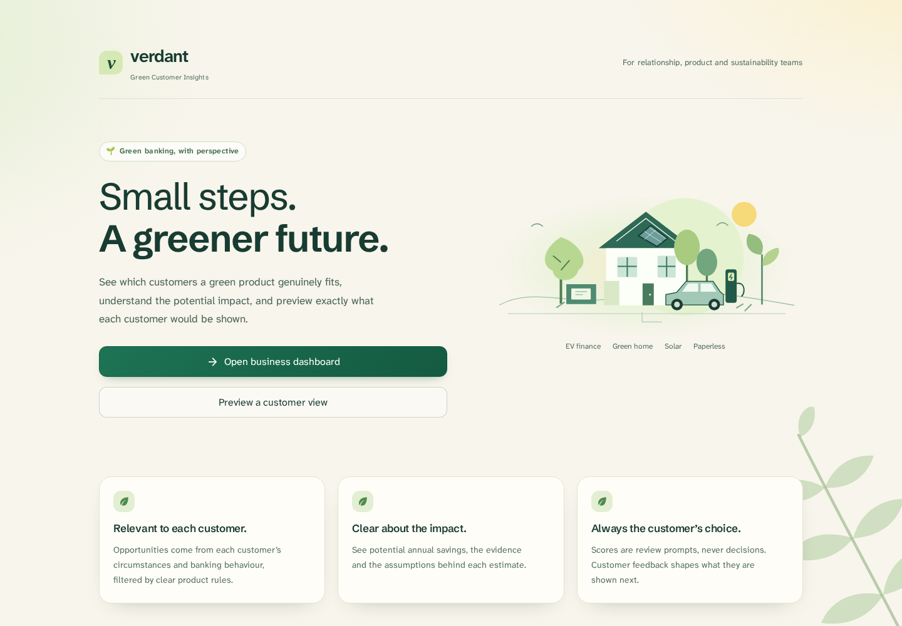
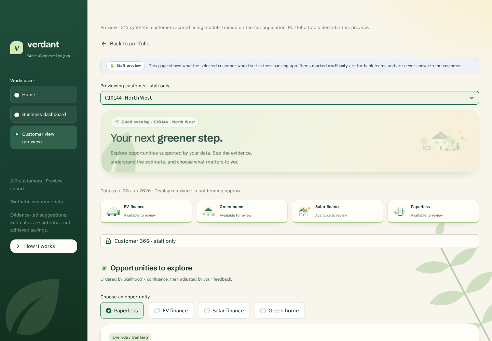
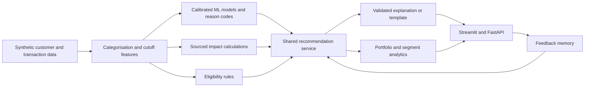

# Verdant — Explainable Green Banking

[](https://github.com/pg1590/verdant-green-banking/actions/workflows/tests.yml)

[](LICENSE)

**Help bank teams find relevant green-product opportunities, explain the evidence, and estimate their potential environmental impact.**

Verdant connects a reproducible synthetic-data pipeline, calibrated machine-learning models, explicit eligibility rules, a sourced carbon calculator, and grounded AI explanations through one shared service. A Streamlit interface gives relationship managers a portfolio dashboard and a preview of each customer's experience; FastAPI exposes the same decisions to other clients.

**Run the trained 213-customer preview immediately. No API key or model training is required.**



[Quick start](#quick-start) · [Features](#what-it-does) · [Architecture](docs/architecture.md) · [API](docs/api.md) · [My contributions](#my-contributions) · [Evaluation](#evaluation-and-limitations)

## What it does

| Capability | What you can explore |
|---|---|
| Portfolio analytics | Product cohorts, regional segments, expected take-ups, estimated impact, dated trends and CSV exports |
| Customer preview | Product status, evidence, confidence, estimated impact, explanations and a branded PDF review brief |
| Four modelled products | EV Finance, Green Home, Solar Finance and Paperless Banking |
| Optional opportunities | Rule-based green-investment and green-loan signals, separated from modelled products |
| Eligibility before ranking | Ownership, existing products, consent, conflicting data and changed circumstances are checked independently of model scores |
| Explainable recommendations | Calibrated take-up probabilities and evidence-gated SHAP reason codes; grounded text is validated before display |
| Feedback memory | Dismiss, cool off, demote or hide suggestions; erase history without changing original scores or impact |
| What-if API | Replay changed customer circumstances through rules, models and impact calculations without saving the simulation |
| Ask-the-portfolio API | Route a question to computed portfolio facts, with grounded wording and an offline fallback |
| Considered motion | Sequenced typography, illustration depth, scroll reveals, responsive layouts and reduced-motion support |



## Quick start

Use Python 3.11 or later. The preview needs the committed models, configuration and data already included here. The bundled models were trained with scikit-learn 1.9.1; its matching version is pinned to keep live scoring and what-if simulations compatible.

```bash
git clone https://github.com/pg1590/verdant-green-banking.git
cd verdant-green-banking
python3 -m venv .venv
source .venv/bin/activate
python -m pip install -r requirements.txt
python -m streamlit run app/main.py
```

On Windows, use `python` instead of `python3` and activate with `.venv\Scripts\activate`.
On Debian/Ubuntu, install the matching `python3-venv` package if `venv` reports that `ensurepip` is unavailable.

Open the URL printed by Streamlit, usually **http://localhost:8501**.

1. Choose **Open business dashboard** to inspect portfolio opportunities, product cohorts and regional segments.
2. Choose **Preview a customer view** to inspect an individual recommendation. `C10144` is a useful example; `C10013` also illustrates an optional Green Loans card.
3. Review why an opportunity is relevant and how its impact is calculated. Staff-only profile, model and provenance details are clearly marked.
4. Open the review action and download the PDF brief, or give feedback to change what is displayed next.

`?page=business` and `?page=customer` open the workspaces directly. The dashboard uses synthetic data and does not submit applications or change bank accounts.

### API

In a second terminal, activate the same environment and run:

```bash
python -m uvicorn api.main:app --host 127.0.0.1 --port 8000
```

Interactive API documentation: **http://localhost:8000/docs**.

```bash
curl http://localhost:8000/health
curl http://localhost:8000/portfolio/summary
curl http://localhost:8000/customers/C10144/recommendations
```

See [API examples](docs/api.md) for feedback, what-if simulations, segment explanations and portfolio questions.

### Explanations and API keys

The default configuration is `LLM_PROVIDER=auto`: without a key, explanations use validated templates. `LLM_PROVIDER=offline` forces templates for repeatable tests. A configured provider can also replay matching committed responses from its cache.

For live generation, install the optional dependencies and create a local `.env` from `.env.example`:

```bash
python -m pip install -r requirements-llm.txt
cp .env.example .env
```

Set `LLM_PROVIDER=gemini` and `GEMINI_API_KEY`, or `LLM_PROVIDER=groq` and `GROQ_API_KEY`. Model identifiers are configurable in `config/settings.yaml`; verify availability for your account. Restart the app after changing provider settings. See [LLM design](docs/llm_design.md) for prompts, validation, retry/fallback and evaluation.

The LLM explains computed results. Eligibility, model probabilities and environmental arithmetic remain owned by their respective components.

## How it works



Features are built from a cutoff-correct observation window; labels belong to a later take-up window. Models select between logistic regression and LightGBM using training cross-validation, with calibration and frozen evidence gates. Recommendations are ranked after eligibility checks. Portfolio impact avoids adding overlapping finance interventions for one customer; paperless impact is reported separately.

[Architecture](docs/architecture.md) · [Data and labels](docs/data.md) · [Impact methodology](docs/carbon_methodology.md) · [Responsible AI](docs/responsible_ai.md)

## Evaluation and limitations

The committed models and reports come from the original seeded **10,000-customer synthetic experiment**, with **13 additional scenario customers excluded from model evaluation**. The runnable preview includes 200 sampled customers and those 13 scenarios.

Recorded validation results for the frozen v3 models:

| Product | Selected model | ROC-AUC | PR-AUC |
|---|---|---:|---:|
| EV Finance | Logistic regression | 0.741 | 0.242 |
| Green Home | LightGBM | 0.673 | 0.094 |
| Solar Finance | Logistic regression | 0.716 | 0.200 |
| Paperless Banking | LightGBM | 0.791 | 0.565 |

These are historical synthetic-data results, not evidence of performance on real bank customers. Green Home has few validation positives and wide uncertainty. Simpler baselines outperform some selected models on validation; income-related disparities and incomplete reason coverage are documented openly.

[Model evaluation](reports/ml_eval.md) · [Full metric tables and intervals](reports/ml_eval_tables.md) · [Fairness](docs/responsible_ai.md) · [LLM evaluation](docs/llm_design.md)

Impact figures are annual potential estimates based on documented assumptions, not achieved savings or site-survey results. Missing inputs stay unavailable. The prototype has no production authentication, credit-underwriting integration or real banking data. It is an independent demonstration, with no bank endorsement or affiliation.

### Tests

```bash
LLM_PROVIDER=offline PYTEST_DISABLE_PLUGIN_AUTOLOAD=1 python -m pytest -q tests
```

On PowerShell, set these environment variables separately before running `python -m pytest -q tests`.
The CI workflow runs the suite on Python 3.11 and 3.12 without provider credentials. Coverage includes data contracts, category boundaries, model calibration, hand-checked carbon formulas, prompt injection, API responses, feedback memory, UI navigation, PDF output and what-if simulations.

### Rebuild the pipeline

```bash
python scripts/run_pipeline.py --fast
# Smaller development run:
python scripts/run_pipeline.py --fast --n 300
```

The full seeded pipeline generates data, categorises transactions, builds features, trains and calibrates models, computes impacts, rebuilds dated snapshots, exports a bundle and prepares explanations. Generated data and local feedback are git-ignored. Keep the frozen held-out evaluation separate from development; do not repeatedly tune against test results.

## My contributions

Maintained by **[Prakhar Gupta](https://github.com/pg1590)**. My original role was integration and product engineering:

- Integrated the team's data, model, impact and explanation contracts into a shared recommendation service.
- Implemented eligibility, ranking, portfolio/segment aggregation and the FastAPI boundary.
- Built and refined the Streamlit workspaces, landing page, motion system, charts and customer journey.
- Connected feedback memory, provider explanations, optional-product and what-if workflows, and review-brief exports.
- Added integration, scenario and UI checks and reproducible preview/run tooling.

This portfolio edition grew from a five-person Megathon project. Data generation, transaction categorisation, impact methods, model training and GenAI work were collaborative contributions; they are not claimed as sole-authored work. See [acknowledgements](ACKNOWLEDGEMENTS.md) and [portfolio notes](docs/portfolio.md).

## Repository guide

| Path | Contents |
|---|---|
| `app/`, `api/` | Streamlit UI, motion, PDF briefs and FastAPI routes |
| `src/` | Data generation, categorisation, features, ML, carbon, recommendation, LLM and memory modules |
| `config/` | Product rules, model settings, reason dictionary, sourced factors and calibration targets |
| `data/preview/`, `data/sample/` | Trained preview bundle and synthetic sample |
| `data/reference/pvgis/` | Regional solar-yield lookup and supporting reference responses |
| `models/` | Frozen model bundles and manifests |
| `reports/`, `outputs/` | Recorded evaluations, plots and test predictions |
| `docs/` | Architecture, methods, API examples, UI screenshots and portfolio notes |

## Credits and licence

Code is released under the [MIT licence](LICENSE), preserving the original team copyright notice. Third-party data retains its own attribution and terms: [data sources](DATA_SOURCES.md). Fonts are Atkinson Hyperlegible Next and Schibsted Grotesk, both under the SIL Open Font License; notices are included with the assets.
