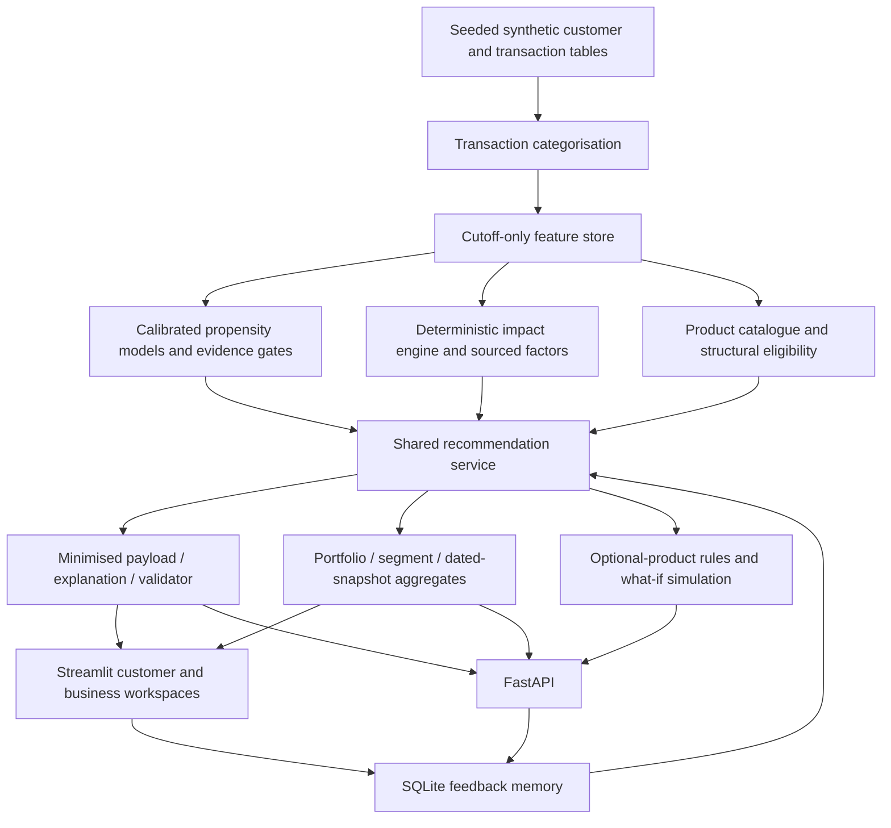

# Architecture

Verdant is a Python application with one shared recommendation service, a Streamlit interface and a FastAPI boundary. A validated JSON bundle is the deployment boundary between data/model generation and serving.

## Decision boundaries

- Eligibility reads customer facts and product rules independently of prediction scores.
- Ranking uses propensity × confidence after eligibility. Feedback can change display order or suppress already-eligible rows, but cannot change original scores or impact.
- Impact arithmetic is deterministic, with factors, units, edition and assumptions attached. Missing inputs produce an unavailable result rather than zero.
- The explanation layer receives a minimised final recommendation. It may explain the evidence but cannot invent eligibility, scores, savings or approvals.
- UI and API call the same service, so display rules and aggregation cannot drift between clients.
- What-if changes are validated, replayed through the relevant logic and returned without saving customer edits.

## Running and rebuilding

The committed 213-customer preview opens without a pipeline rebuild. A complete seeded experiment is available through `python scripts/run_pipeline.py --fast`; generated data stays outside version control. Runtime selection and feedback wiring live in `src/recommend/runtime.py`.

| Stage | Module |
|---|---|
| Generate synthetic data and labels | `src/data_gen/` |
| Categorise transactions | `src/categorisation/` |
| Build features and dated snapshots | `src/features/` |
| Train, calibrate and explain models | `src/models/` |
| Convert spend and estimate impact | `src/carbon/` |
| Apply rules, ranking, aggregation and simulations | `src/recommend/` |
| Explain, validate, cache and evaluate wording | `src/llm/` |
| Apply feedback preferences | `src/memory/` |
| Serve and present | `api/`, `app/` |

Contract details: [integration](integration.md). Methodology and boundaries: [impact calculations](carbon_methodology.md), [data](data.md), [Responsible AI](responsible_ai.md).

The prototype runs on synthetic data. Production authentication, authorisation, enterprise data governance and financial decision integrations are outside its current implementation.
