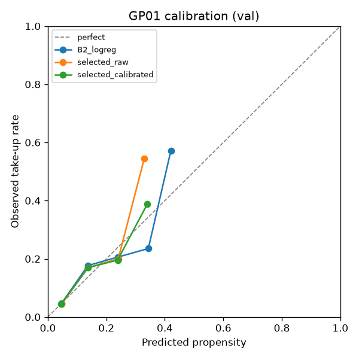
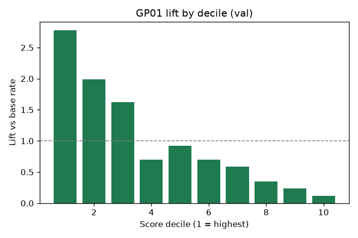
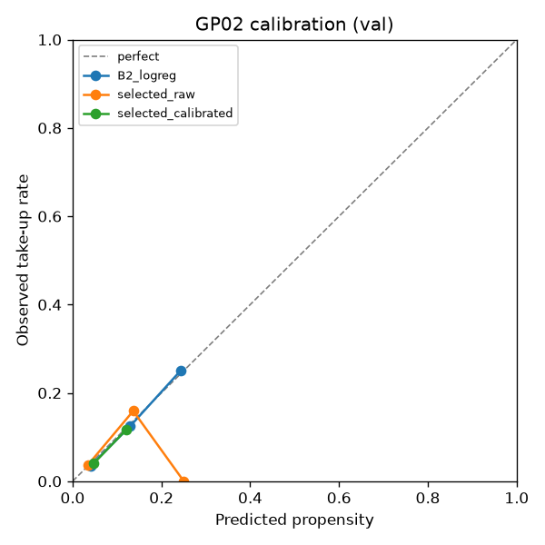
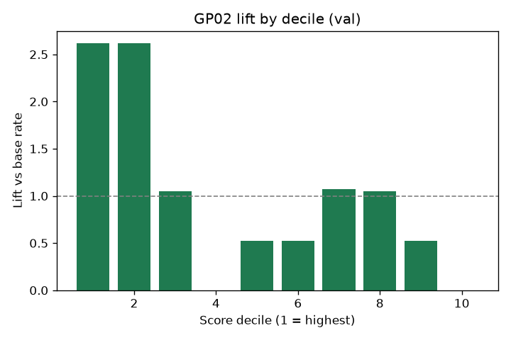
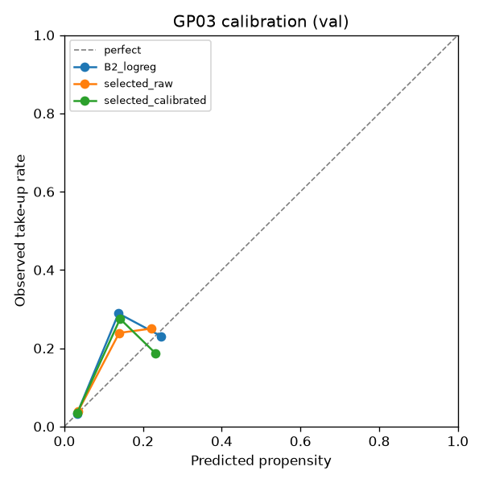
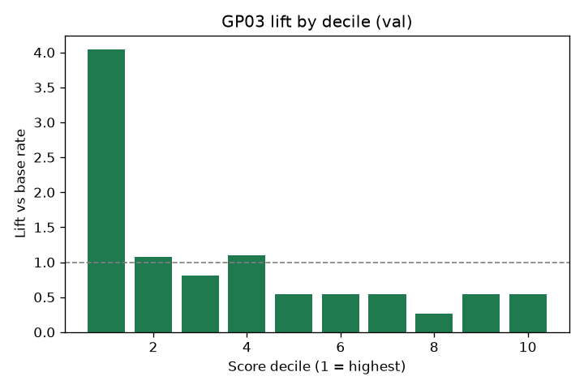
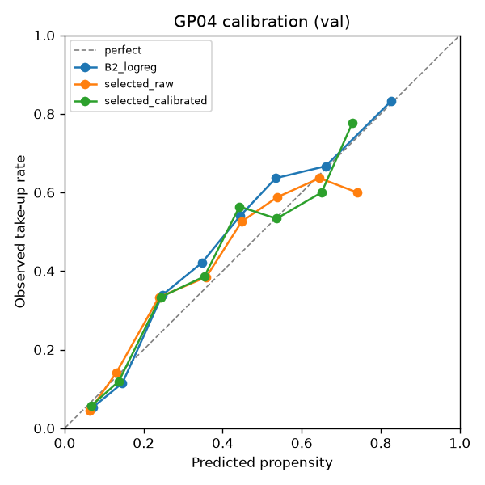
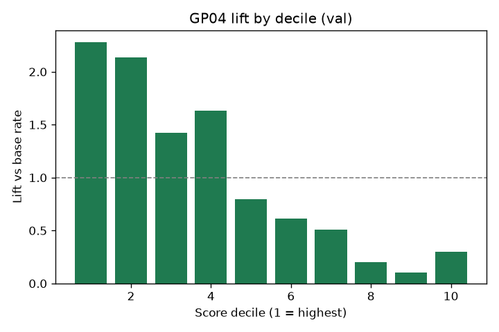

# Validation metrics (auto-generated by src/models/train.py)

## GP01

| Model | ROC-AUC (95% CI) | PR-AUC (95% CI) | Brier | ECE | Precision@10% | Lift@10% |
|---|---|---|---|---|---|---|
| B1_rule | 0.624 (0.564–0.672) | 0.120 (0.090–0.147) | 0.0750 | 0.0081 | 0.196 | 2.34 |
| B2_logreg | 0.746 (0.692–0.787) | 0.214 (0.153–0.303) | 0.0721 | 0.0117 | 0.225 | 2.69 |
| lgbm_calibrated | 0.730 (0.671–0.781) | 0.225 (0.157–0.326) | 0.0719 | 0.0091 | 0.255 | 3.04 |
| selected_raw | 0.741 (0.682–0.783) | 0.242 (0.174–0.323) | 0.0719 | 0.0134 | 0.225 | 2.69 |
| selected_calibrated | 0.741 (0.682–0.783) | 0.242 (0.174–0.323) | 0.0718 | 0.0100 | 0.225 | 2.69 |

Selected: **logreg** (train-CV average precision: lgbm 0.205, logreg 0.216). n_val=1025, positives=86, base rate=0.084, reason-code coverage=85.9%

Coefficient sign contradicts model.yaml direction: num_vehicles, spend_automotive_m

 

Top SHAP drivers: income_band_ord (0.418), has_vehicle_loan (0.166), spend_fuel_prior_m (0.156), is_urban (0.152), spend_fuel_m (0.147)

## GP02

| Model | ROC-AUC (95% CI) | PR-AUC (95% CI) | Brier | ECE | Precision@10% | Lift@10% |
|---|---|---|---|---|---|---|
| B1_rule | 0.472 (0.388–0.586) | 0.047 (0.027–0.074) | 0.0468 | 0.0080 | 0.000 | 0.00 |
| B2_logreg | 0.790 (0.694–0.882) | 0.177 (0.092–0.351) | 0.0439 | 0.0065 | 0.179 | 3.67 |
| logreg_calibrated | 0.751 (0.652–0.860) | 0.139 (0.073–0.269) | 0.0448 | 0.0092 | 0.179 | 3.67 |
| selected_raw | 0.673 (0.562–0.779) | 0.094 (0.053–0.172) | 0.0473 | 0.0132 | 0.128 | 2.62 |
| selected_calibrated | 0.673 (0.562–0.779) | 0.094 (0.053–0.172) | 0.0460 | 0.0069 | 0.128 | 2.62 |

Selected: **lgbm** (train-CV average precision: lgbm 0.146, logreg 0.140). n_val=388, positives=19, base rate=0.049, reason-code coverage=97.7%

 

Top SHAP drivers: spend_home_improvement_m (0.414), energy_spend_per_person_m (0.398), income_band_ord (0.374), est_electricity_kwh_year (0.266), has_mortgage (0.240)

## GP03

| Model | ROC-AUC (95% CI) | PR-AUC (95% CI) | Brier | ECE | Precision@10% | Lift@10% |
|---|---|---|---|---|---|---|
| B1_rule | 0.520 (0.445–0.585) | 0.056 (0.041–0.078) | 0.0512 | 0.0122 | 0.058 | 1.08 |
| B2_logreg | 0.723 (0.641–0.821) | 0.210 (0.109–0.366) | 0.0474 | 0.0120 | 0.246 | 4.58 |
| lgbm_calibrated | 0.726 (0.633–0.824) | 0.240 (0.139–0.393) | 0.0481 | 0.0109 | 0.203 | 3.77 |
| selected_raw | 0.716 (0.621–0.816) | 0.200 (0.105–0.358) | 0.0482 | 0.0102 | 0.217 | 4.04 |
| selected_calibrated | 0.716 (0.621–0.816) | 0.200 (0.105–0.358) | 0.0480 | 0.0117 | 0.217 | 4.04 |

Selected: **logreg** (train-CV average precision: lgbm 0.121, logreg 0.130). n_val=688, positives=37, base rate=0.054, reason-code coverage=88.4%

Coefficient sign contradicts model.yaml direction: has_savings

 

Top SHAP drivers: income_band_ord (0.487), electricity_kwh_per_person (0.234), has_mortgage (0.159), is_detached_or_semi (0.147), energy_spend_per_person_m (0.142)

## GP04

| Model | ROC-AUC (95% CI) | PR-AUC (95% CI) | Brier | ECE | Precision@10% | Lift@10% |
|---|---|---|---|---|---|---|
| B1_rule | 0.692 (0.634–0.744) | 0.423 (0.327–0.491) | 0.1705 | 0.0149 | 0.444 | 1.63 |
| B2_logreg | 0.795 (0.743–0.837) | 0.560 (0.474–0.662) | 0.1599 | 0.0595 | 0.639 | 2.34 |
| logreg_calibrated | 0.796 (0.745–0.838) | 0.570 (0.482–0.667) | 0.1582 | 0.0595 | 0.639 | 2.34 |
| selected_raw | 0.791 (0.737–0.836) | 0.565 (0.475–0.662) | 0.1587 | 0.0419 | 0.611 | 2.24 |
| selected_calibrated | 0.791 (0.737–0.836) | 0.565 (0.475–0.662) | 0.1592 | 0.0415 | 0.611 | 2.24 |

Selected: **lgbm** (train-CV average precision: lgbm 0.527, logreg 0.522). n_val=363, positives=99, base rate=0.273, reason-code coverage=55.9%

 

Top SHAP drivers: avg_app_logins_m (0.815), avg_web_sessions_m (0.164), income_band_ord (0.150), paper_statements_12m (0.000)
